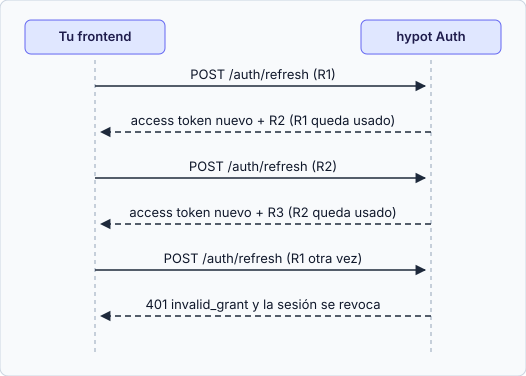

import { Aside, Code, TabItem, Tabs } from '@astrojs/starlight/components';
import refresh from '../../../../examples/frontend/refresh.js?raw';
import refreshCurl from '../../../../examples/curl/refresh.sh?raw';
import rateLimited from '../../../../examples/curl/rate-limited.sh?raw';

**Cada refresh devuelve un refresh token nuevo y marca el anterior como usado. Haz como máximo un refresh a la vez por usuario, entre todas las pestañas.** Presentar un refresh token ya usado se interpreta como robo: la llamada falla con `invalid_grant` y Auth **revoca la sesión completa**, incluido el token recién emitido.

## El endpoint

<Tabs syncKey="lenguaje">
  <TabItem label="fetch (navegador)">
    El método `client.refresh(refreshToken)` del [cliente base](/frontend/registro-y-confirmacion/#cliente-base) hace la llamada. El código completo, con candado y reintento, está más abajo.
  </TabItem>
  <TabItem label="curl">
    <Code code={refreshCurl} lang="sh" title="refresh.sh" />

    Guarda el `refresh_token` **nuevo** de la respuesta: el que enviaste ya quedó usado.
  </TabItem>
</Tabs>

Un refresh correcto devuelve el mismo formato que el login: `access_token`, `token_type`, `expires_in` y un `refresh_token` nuevo. **Reemplaza el refresh token almacenado de inmediato**, antes de hacer cualquier otra cosa.

| Caso | Respuesta |
|------|-----------|
| Token desconocido, vencido, de otra app, usado o revocado | `401 invalid_grant`, idéntico para todos |
| `Origin` no asociado a tu `client_id` | El mismo `401 invalid_grant` (la respuesta nunca revela si un token es válido). Si todos tus refresh fallan así, revisa los orígenes permitidos. |
| Token usado o revocado | El mismo `401`, y además se revoca la sesión completa (salvo el caso de gracia) |
| Cuerpo mal formado | `400 invalid_request` |
| `client_id` desconocido o inactivo | `400 invalid_client` (un error de configuración). Esta respuesta no lleva cabeceras CORS, así que el navegador la muestra como un error de red (`network_error`), no como `invalid_client`. |
| Almacén del limitador caído | `503 temporarily_unavailable`. No es una sesión muerta: conserva los tokens y reintenta más tarde. |
| Límite por IP | `429 rate_limited` con `Retry-After`. **No** es `invalid_grant`: conserva la sesión y reintenta tras la espera. |

Ante `invalid_grant`, borra tus tokens y envía a la persona al login. **Solo** ese error cierra la sesión: un `503`, un `5xx`, una caída de red tras el reintento o un error desconocido no prueban que la sesión haya muerto. En esos casos conserva los tokens y reintenta más tarde (`refresh.js` devuelve `{ status: 'unavailable' }`). No dejes escritas en tu código las duraciones (30 días de sesión y 7 sin uso son los valores por defecto del operador): lee `expires_in` y trata cualquier `invalid_grant` como "inicia sesión otra vez".

## Serializar los refresh

**Regla: como máximo un refresh en vuelo por usuario, entre todas las pestañas.** Dos pestañas (o dos peticiones en paralelo) que renuevan a la vez envían el mismo token. Una gana. La otra cae en el camino de gracia, que revoca el token nuevo de la ganadora, de modo que el siguiente refresh de la ganadora termina la sesión.

El código combina dos mecanismos:

1. **Una promesa compartida por página**: llamadas simultáneas en la misma pestaña causan una sola petición.
2. **`navigator.locks`**: un candado compartido entre pestañas. Dentro del candado se **vuelve a leer** el token almacenado, porque otra pestaña pudo rotarlo mientras esperabas.

<Code code={refresh} lang="js" title="refresh.js" />

`navigator.locks` solo existe en un **contexto seguro** (`https://` o `http://localhost`). En una página servida por `http` en otro host, `navigator.locks` es `undefined` y `createRefresher` fallará al renovar: sirve tu aplicación por HTTPS.

Si tus pestañas no comparten almacenamiento (tokens solo en memoria), cada pestaña tiene su propia sesión y no hay nada que coordinar.

<Aside type="note" title="Qué prueban los tests de este ejemplo">
Las pruebas ejecutan `refresh.js` contra la API real con un candado simulado en Node (un mutex que respeta el orden, como `navigator.locks`). Comprueban que dos "pestañas" con el mismo almacenamiento y el mismo candado rotan en cadena sin perder la sesión. También reproducen, con llamadas secuenciales, lo que ocurre si no serializas: el segundo uso del token viejo entra por la ventana de gracia y revoca el token de la ganadora, y su siguiente refresh termina la sesión. El comportamiento real del candado entre pestañas de un navegador **no** está cubierto: se verifica a mano con la prueba de humo del repositorio de la API.
</Aside>

## Respuesta perdida y ventana de gracia

Si la red se cae después de que Auth procesó el refresh pero antes de que recibas la respuesta, sigues teniendo el token viejo. Auth perdona **un** reintento:

| Reintento del token viejo | Resultado |
|---------------------------|-----------|
| Unos 10 s o menos después de la rotación, desde la misma red (misma IP, o el mismo /64 en IPv6), primer reintento | `200` con un par nuevo. La sesión sobrevive. |
| Más tarde que la ventana, desde otra IP, o un segundo reintento | `401 invalid_grant` y la sesión se revoca |

La ventana es una configuración del servidor (10 s por defecto): no la escribas en tu código. Está pensada para respuestas perdidas, **no** para pestañas que compiten.

Reglas del reintento (ya aplicadas en `refresh.js`):

- Reintenta como máximo **una vez** por token, y solo cuando el primer intento terminó sin respuesta HTTP (error de red o tiempo agotado). Nunca después de un `401` y nunca en bucle.
- Si el reintento responde `invalid_grant` (fuera de la ventana o desde otra red), la sesión se revocó: borra los tokens y pide iniciar sesión. Si el reintento también termina sin respuesta, no borres nada: `refresh.js` devuelve `{ status: 'unavailable' }` y conserva el token por si el primer intento sí llegó a procesarse. Reintenta más tarde; si la caída supera la ventana, el siguiente intento recibirá `invalid_grant`.
- Un `429` no es una respuesta perdida: espera `Retry-After` y reintenta el mismo token.
- Tras un reintento correcto, reemplaza el token almacenado como en un refresh normal.

## Límite de frecuencia (`429`)

Con demasiados refresh desde una misma IP, Auth responde `429 rate_limited` con la cabecera `Retry-After` (segundos enteros). La sesión sigue viva: conserva los tokens y reintenta el mismo refresh token cuando pase la espera.

<Tabs syncKey="lenguaje">
  <TabItem label="fetch (navegador)">
    `refresh.js` devuelve `{ status: 'rate_limited', retryAfter }` y deja los tokens intactos.
  </TabItem>
  <TabItem label="curl">
    <Code code={rateLimited} lang="sh" title="rate-limited.sh" />
  </TabItem>
</Tabs>

## Lista de verificación

- [ ] Hay un solo refresh en vuelo por página (promesa compartida) y por navegador (`navigator.locks`).
- [ ] Relees el token almacenado dentro del candado.
- [ ] Reemplazas el refresh token antes que cualquier otra cosa.
- [ ] Reintentas como máximo una vez, y solo tras un error de red.
- [ ] Un `429`, un `503` o una caída de red no cierran la sesión: conservas los tokens.
- [ ] Ante `invalid_grant` borras tokens y envías al login.

## Siguiente paso

Continúa con [Logout](/frontend/logout/).
